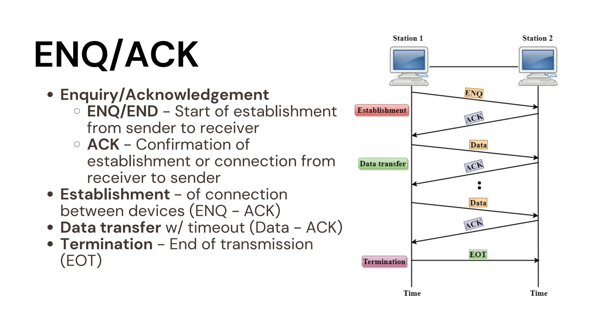
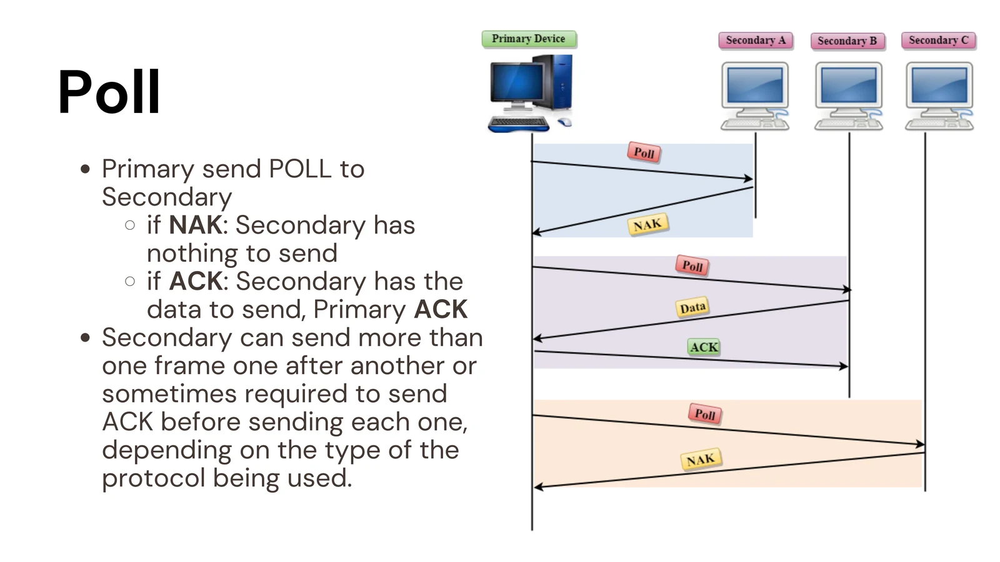
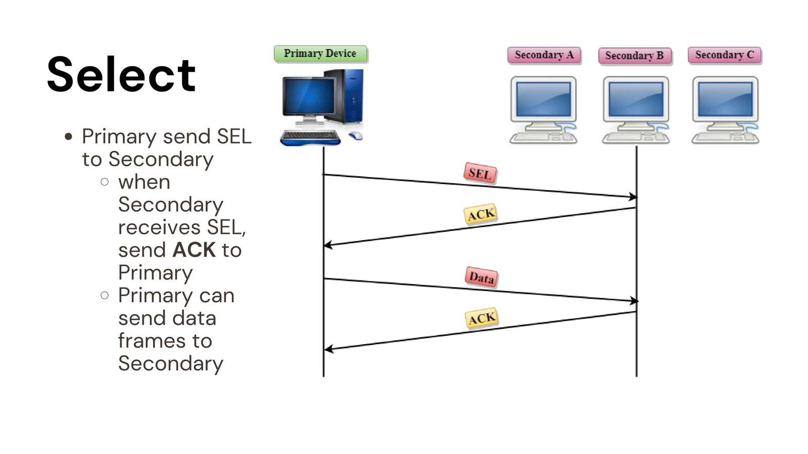
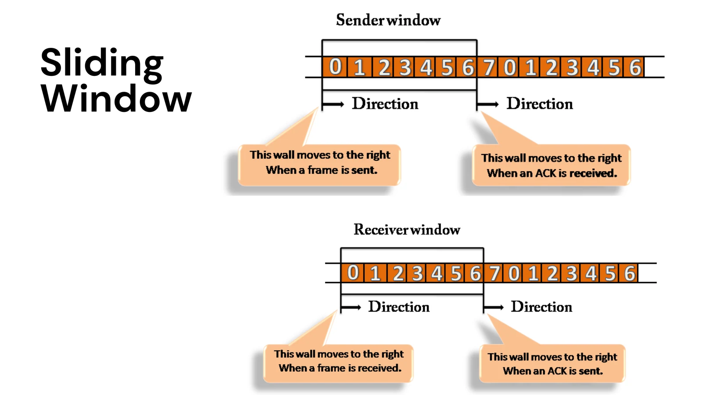
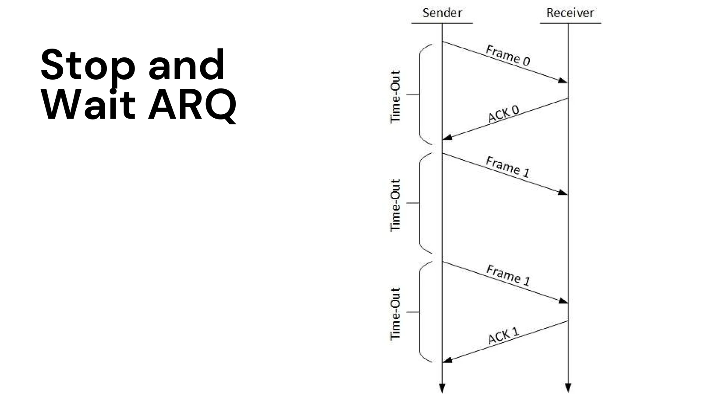
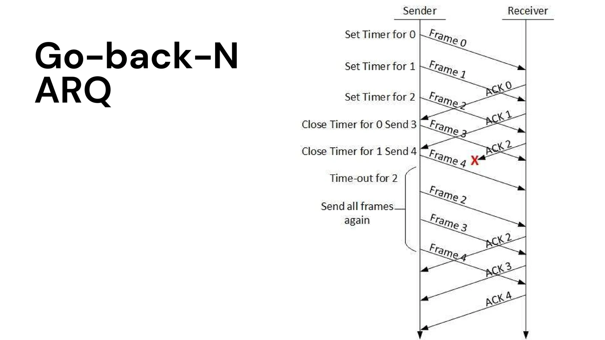
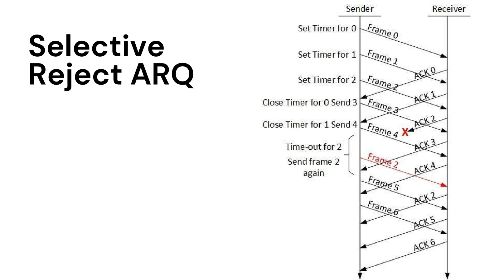
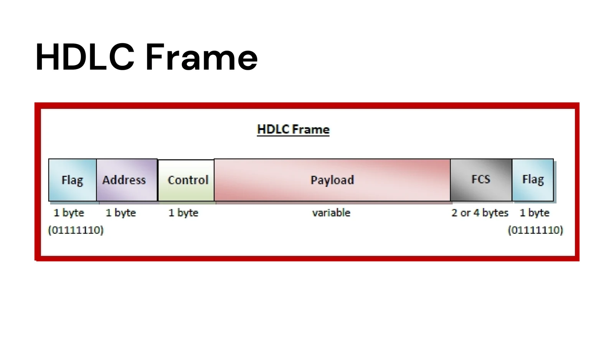
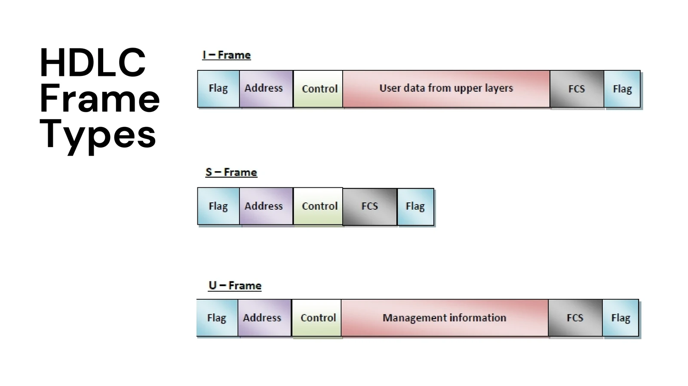

# Data Link Control and Protocols: Course Notes

## I. Data Link Control

Data Link Control (DLC) coordinates reliable transfer across a physical link. It organizes data into frames and manages which station may transmit, how fast a sender transmits, and what happens after damage or loss. These concerns are especially visible on a half-duplex link, where only one endpoint can transmit at a time.

## II. Line Discipline

Line discipline establishes who may send and when.

- **ENQ/ACK:** The sender sends an enquiry (ENQ); the receiver acknowledges (ACK) before data transfer. A timeout allows the sender to retry when a response is missing; repeated failure ends the attempt. An end-of-transmission (EOT) signal marks completion.
- **Poll/select:** A primary station controls exchanges with secondary stations. It polls a secondary when it wants to receive data; it selects a secondary when it has data to send. The response indicates readiness or acknowledges the exchange.

*Source: `Data Link Control and Protocols.pdf`, p. 18.*

*Source: `Data Link Control and Protocols.pdf`, p. 21.*

*Source: `Data Link Control and Protocols.pdf`, p. 22.*

## III. Flow Control

Flow control prevents a fast sender from overwhelming a receiver with limited processing speed or buffer space.

- **Stop-and-wait:** Send one frame, then wait for its acknowledgment before sending another. It is simple but leaves the link idle while waiting.
- **Sliding window:** Permit several numbered frames to be in transit. As acknowledgments arrive, the sending window advances, improving link use while still limiting outstanding data.

*Source: `Data Link Control and Protocols.pdf`, p. 25.*

## IV. Error Control and ARQ

Error control detects damaged or missing frames and arranges retransmission. Automatic Repeat reQuest (ARQ) combines acknowledgments, sequence numbers, and timeouts with retransmission.

- **Stop-and-wait ARQ:** Retransmit the outstanding frame if its acknowledgment does not arrive before timeout. Sequence numbers distinguish a retransmission from a new frame.
- **Go-back-N ARQ:** If a frame is lost or damaged, retransmit that frame and later outstanding frames in the window.
- **Selective Reject (selective-repeat) ARQ:** Retransmit only the missing or damaged frame; the receiver can hold later correctly received frames until the gap is filled. This saves retransmissions but needs more buffering and tracking.

*Source: `Data Link Control and Protocols.pdf`, p. 28.*

*Source: `Data Link Control and Protocols.pdf`, p. 29.*

*Source: `Data Link Control and Protocols.pdf`, p. 30.*

## V. High-Level Data Link Control

HDLC is a bit-oriented family of data-link protocols for point-to-point or multipoint links. A flag (`01111110`) delimits each frame. Its fields are flag, address, control, payload, frame check sequence (FCS), and closing flag. The FCS uses CRC for error detection.

In the frame convention shown in the lesson, the control field is one or two bytes and the FCS is two or four bytes. HDLC frame types serve different purposes; their first control-field bits identify the type:

- **Information (I) frames** start with `0`, carry user data, and can piggyback acknowledgments and other flow/error-control information.
- **Supervisory (S) frames** start with `10` and carry flow or error-control information when it is not piggybacked on user data.
- **Unnumbered (U) frames** start with `11`, handle link management, and can also carry information when required.

In **Normal Response Mode (NRM)**, a primary controls the exchange and secondaries respond. **Asynchronous Balanced Mode (ABM)** lets either endpoint act as a peer able to initiate transmission; it is used for point-to-point links.

*Source: `Data Link Control and Protocols.pdf`, p. 35.*

*Source: `Data Link Control and Protocols.pdf`, p. 37.*

## Sources

- `Data Link Control and Protocols.pdf`, pp. 15-37.
- [RFC 1662: HDLC-like Framing](https://www.rfc-editor.org/rfc/rfc1662.html).
