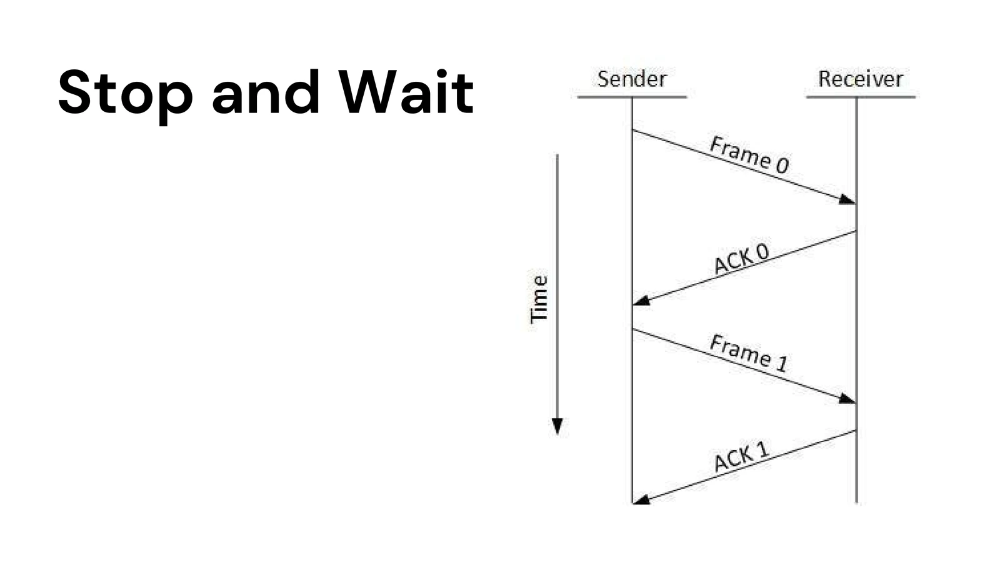

# Data Link Control and Protocols

**Date:** 2026-10-29

| Cue / Keywords | Notes |
| :--- | :--- |
| **Data Link Control** | Data-link service coordinates reliable frame transfer over a physical link. It handles line discipline, flow control, and error control. On a half-duplex link, endpoints must coordinate to avoid transmitting at once. |
| **Line Discipline** | Determines which station may send and when. |
| **ENQ/ACK** | Sender requests to begin with an enquiry (ENQ); receiver responds with ACK. Transfer uses data/acknowledgment exchanges; timeout permits retries. EOT marks the end. Repeated failure can cause the sender to give up. |
| **Poll/Select** | In primary/secondary arrangements, the primary **polls** to invite a secondary to send and **selects** a secondary when the primary has data to send. Secondary responses acknowledge or indicate readiness. |
| **Flow Control** | Limits outstanding data so a sender does not overrun a receiver's processing capacity or buffer. |
| **Stop-and-Wait** | Send one frame and wait for its ACK. Simple but idle during each round trip. |
| **Sliding Window** | Several sequenced frames may be outstanding. As ACKs arrive, the window advances, improving link utilization while bounding in-flight data. |
| **Error Control / ARQ** | Detects damaged or missing frames and uses sequence numbers, ACKs, timers, and retransmission to recover. |
| **Stop-and-Wait ARQ** | Timeout retransmits the outstanding frame. Sequence numbers help distinguish a retry from new data. |
| **Go-Back-N ARQ** | A failure causes retransmission of the missing frame and subsequent outstanding frames. |
| **Selective Reject ARQ** | Retransmits only missing or damaged frames; receiver buffers later frames until a gap is repaired. It reduces needless retransmissions at the cost of buffering and tracking. |
| **HDLC** | Bit-oriented protocol family for point-to-point and multipoint links. `01111110` flags frame boundaries; the FCS uses CRC for error detection. |
| **HDLC Fields** | Flag, address, control, payload, FCS, closing flag. Address identifies a station; control is 1 or 2 bytes and supports link operation; payload carries network-layer data; FCS is 2 or 4 bytes and checks errors. |
| **HDLC Frame Types** | Leading control bits: **I** starts `0`, carries user data, possibly with piggybacked control; **S** starts `10`, carries supervisory flow/error control; **U** starts `11`, handles link management. |
| **Transfer Modes** | **NRM:** primary initiates/control exchanges; secondary responds. **ABM:** either peer may initiate on a balanced point-to-point link. |
| **Flow vs. Error Control** | Flow control prevents receiver overload; error control detects loss/corruption and coordinates recovery. |

## Diagrams

### Line discipline

*Source: `Data Link Control and Protocols.pdf`, p. 18.*

*Source: `Data Link Control and Protocols.pdf`, p. 21.*

*Source: `Data Link Control and Protocols.pdf`, p. 22.*

### Flow and error control

*Source: `Data Link Control and Protocols.pdf`, p. 24.*

*Source: `Data Link Control and Protocols.pdf`, p. 25.*

*Source: `Data Link Control and Protocols.pdf`, p. 28.*

*Source: `Data Link Control and Protocols.pdf`, p. 29.*

*Source: `Data Link Control and Protocols.pdf`, p. 30.*

### HDLC

*Source: `Data Link Control and Protocols.pdf`, p. 35.*

*Source: `Data Link Control and Protocols.pdf`, p. 37.*

---

### Summary
Data-link protocols coordinate access, regulate frame flow, and recover from transmission errors. Sliding windows improve utilization, while ARQ variants trade retransmission work for receiver buffering. HDLC frames carry data and control information between link stations.

## References

- `Data Link Control and Protocols.pdf`, pp. 15-37.
- [RFC 1662: HDLC-like Framing](https://www.rfc-editor.org/rfc/rfc1662.html).
